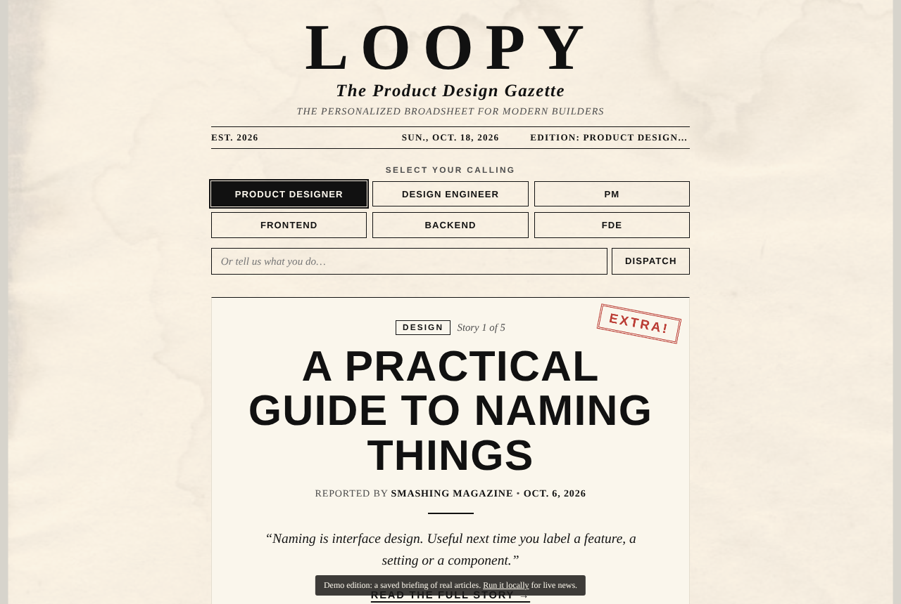

# loopy

A personalized tech newspaper. Tell it what you do, and it prints up to five real stories that matter for your role.



**Live:** https://manya-5.github.io/loopy/ (a demo edition that replays a saved briefing of real articles; the live agent runs on Google Cloud)

## Why I built this

Keeping up with design and AI news meant skimming ten feeds that were mostly irrelevant to me. I wanted one short briefing that knows my role and explains why each story matters. Every item has to be a real article with a real link, because a news agent that makes things up is worse than none.

## How it works

- **Pick a role or describe your job.** Six role chips (Product Designer, Design Engineer, PM, Frontend, Backend, FDE) or free text.
- **The agent fetches, then picks.** An ADK agent on Gemini calls one tool that pulls from 17 curated sources stored in Firestore: Hacker News plus RSS feeds such as Smashing Magazine, the Figma blog and the GitHub blog. Only items from the last 30 days count.
- **Strict grounding.** It picks up to five items, leads with news, allows at most two longer reads, and never invents a story or a link. If it finds fewer than five, it shows fewer.
- **It remembers you.** Vertex AI Memory Bank keeps your role between visits, so "give me my briefing" just works.
- **The newspaper front end.** Stories arrive as A2UI cards and are set in a vintage broadsheet, one story per page, with a page flip, a typewriter loader and a rubber stamp.

The agent runs on Vertex AI Agent Runtime and talks to the front end over the A2A protocol through a small FastAPI proxy. [TECHNICAL.md](TECHNICAL.md) has the full architecture and deployment guide.

## Run it locally

Needs Python 3.11+, [uv](https://docs.astral.sh/uv/) and a Google Cloud project with Vertex AI and Firestore.

```bash
git clone https://github.com/manya-5/loopy.git
cd loopy
cp .env.example .env              # add your Google Cloud project
uvx google-agents-cli setup
agents-cli install
uv run python scripts/seed_sources.py   # load the news sources into Firestore
agents-cli playground             # chat with the agent locally
```

To run the newspaper front end against a deployed agent:

```bash
cd frontend
pip install -r requirements.txt
export AGENT_ENGINE_RESOURCE_NAME="projects/<number>/locations/<region>/reasoningEngines/<id>"
python main.py                    # http://localhost:8080
```

To preview just the demo edition, run `python3 -m http.server 8000 --directory docs` and open http://localhost:8000.
